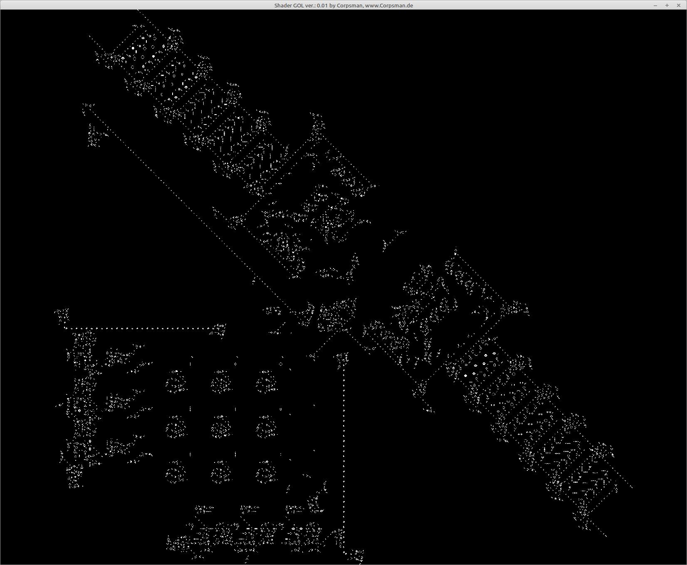

# Game of life (with shaders)

Inspired by [this](https://www.youtube.com/watch?v=XcII7comJ00) youtube video and the fact that i am on the way of learning how to use shaders i gave it a try ;).

Features:
- CTRL+L can load .bmp files with presetted machines
- Left mouse draws new cells
- Right mouse erases everything

Dependencies:
- OpenGL ([dglOpenGL](https://github.com/saschawillems/dglopengl) and TOpenGLControl from the LCL)

Needed Lazarus packages:

LazOpenGLContext

