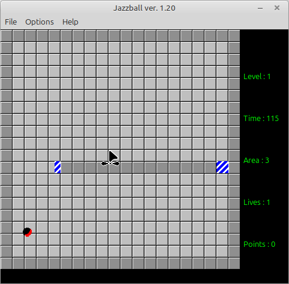

# Jazzball

I can not remember anymore when i got inspired to recode this game, all i remember is that i initially startet coding it under Delphi5 with DirectX, then ported it to Lazarus OpenGL, and now its Lazarus OpenGl using Shaders. The Original can be found by searching for "Jezzbal".

Features:
- Highscores

Dependencies:

DGLOpenGL ( https://github.com/saschawillems/dglopengl )

Needed Lazarus packages:

LazOpenGLContext
